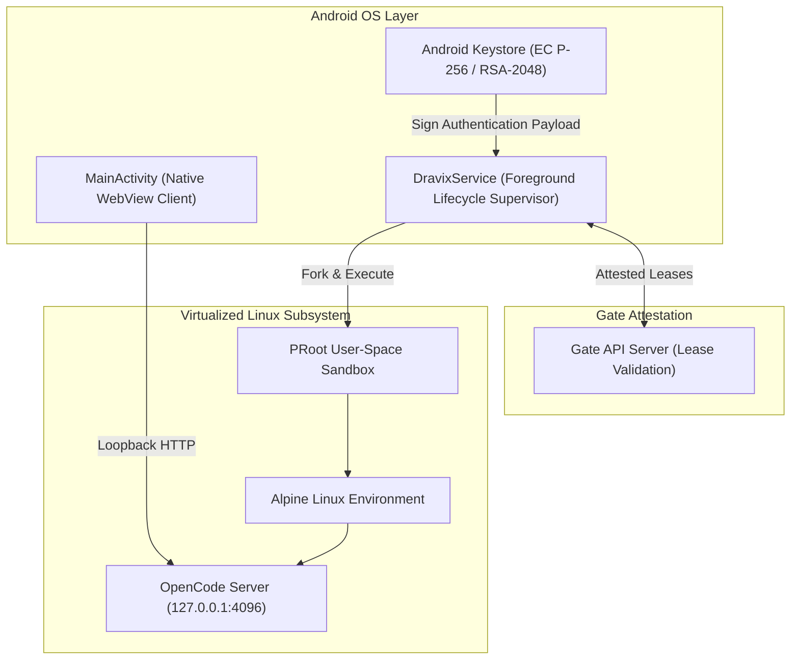

<p align="center">
  
</p>

<p align="center">
  <a href="https://github.com/trndravix2/opencodeforandroid"></a>
  <a href="https://kotlinlang.org"></a>
  <a href="#"></a>
  <a href="#"></a>
  <a href="#"></a>
  <a href="#"></a>
</p>

---

## Overview

**OpenCode for Android** is a self-contained mobile environment engineered to run full-stack autonomous AI coding engines directly on Android devices. By pairing a custom-compiled user-space PRoot subsystem with a bundled Alpine Linux root filesystem, it provides an isolated, rootless execution runtime for OpenCode without requiring Termux, custom recovery, or device rooting.

The application embeds process supervisors, cryptographic attestation routines, and an accelerated WebView interface into a unified APK package.

---

## Technical Highlights

- **Rootless User-Space Virtualization**
  - Executes via PRoot binary modules (`arm64-v8a` and `x86_64`) targeting user-space syscall interception.
  - Bundles a preconfigured Alpine Linux root filesystem (`rootfs-aarch64` / `rootfs-x86_64`).
  - Zero external dependency downloads during initial device provisioning.

- **Embedded OpenCode Engine Supervision**
  - Automatically manages, health-checks, and restarts the OpenCode HTTP service on loopback address `127.0.0.1:4096`.
  - Native lifecycle monitors prevent orphaned processes during background app suspension.

- **Hardware-Backed Device Attestation**
  - Isolates cryptographic keys (`EC P-256` and `RSA-2048`) inside the Android Hardware Keystore.
  - Provides hardware-signed payload verification against gate servers.
  - Monotonic time tracking (`SystemClock.elapsedRealtime()`) protects lease renewal sequences against device clock manipulation.

- **Persistent Service Daemon**
  - `DravixService` runs as an explicit foreground service to preserve compute and TCP socket connectivity during background multitasking.
  - Hardware-accelerated client container with clean, dark-mode native interface.

---

## Architecture Flow



---

## Repository Structure

```text
├── app/
│   ├── src/main/
│   │   ├── AndroidManifest.xml          # Package configuration & permissions
│   │   ├── assets/                      # Application assets, UI, and Linux binaries
│   │   │   └── www/                     # Web client UI assets
│   │   ├── java/com/dravix/ai/          # Kotlin engine sources
│   │   │   ├── AssetVault.kt            # Decryption and disk provisioning logic
│   │   │   ├── DravixEngine.kt          # PRoot execution and process supervisor
│   │   │   ├── DravixService.kt         # Persistent foreground service
│   │   │   ├── GateActivity.kt          # Attestation & lease validation UI
│   │   │   ├── GateApi.kt               # Network client & SSL certificate pins
│   │   │   ├── GateCrypto.kt            # Android Keystore cryptographic signing
│   │   │   ├── LeaseManager.kt          # Lease refresh state machine
│   │   │   └── MainActivity.kt          # Main WebView container
│   │   ├── jniLibs/                     # Native PRoot binaries per architecture
│   │   └── res/                         # Interface resources, layouts, and icons
│   └── build.gradle.kts                 # Application build script
├── tools/                               # Automation and cryptographic tooling
│   ├── mock_gate.py                     # Local attestation test server
│   └── encrypt_assets.py                # Asset encryption tool
├── assets/
│   └── banner.svg                       # OpenCode for Android vector banner
└── build.gradle.kts                     # Root project configuration
```

---

## Building from Source

### Requirements
- **JDK:** OpenJDK 17 or higher
- **Android SDK:** `compileSdk 34`, `minSdk 24`, `targetSdk 28`
  *(Note: `targetSdk` is pinned to 28 to preserve execve execution rights in application internal storage).*

### Compilation

```bash
git clone https://github.com/trndravix2/opencodeforandroid.git
cd opencodeforandroid
./gradlew assembleDebug
```

The resulting package will be produced under:
`app/build/outputs/apk/debug/app-debug.apk`

---

## Security & Privacy Configuration

- Private signing keystores (`*.jks`, `*.keystore`), environment properties (`keystore.properties`, `local.properties`), and server cryptographic keys are strictly excluded from git tracking.
- Precompiled binaries exceeding GitHub's standard transfer limits are isolated via `.gitignore` rules.

---

## Author & Maintainer

- **Developer:** TRNDRAVIX
- **Repository:** [trndravix2/opencodeforandroid](https://github.com/trndravix2/opencodeforandroid)
