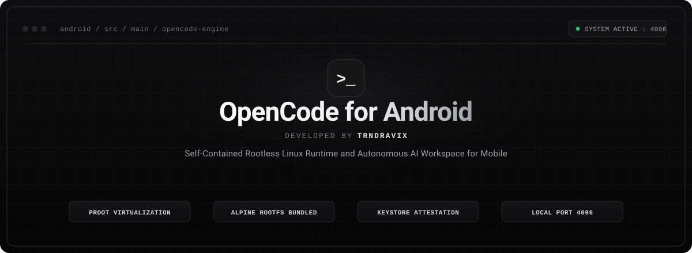
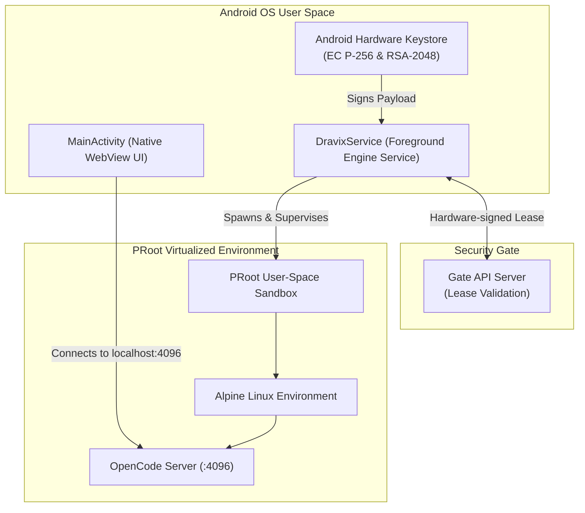

<p align="center">
  
</p>

<p align="center">
  <a href="https://github.com/trndravix2/opencodeforandroid"></a>
  <a href="https://kotlinlang.org"></a>
  <a href="#"></a>
  <a href="#"></a>
  <a href="#"></a>
</p>

---

## ⚡ Overview

**Dravix OpenCode for Android** is an all-in-one, rootless mobile AI coding workspace. It embeds an entire containerized Linux runtime (**PRoot + Alpine Linux**) and the **OpenCode** AI agent engine directly into an Android application, allowing developers to run, manage, and interact with full-featured autonomous coding sessions locally on mobile hardware without requiring root permissions.

---

## ✨ Key Features

- **🚀 Rootless Linux Containerization**
  - Powered by custom-compiled user-space `PRoot`.
  - Bundles a lightweight, tuned **Alpine Linux** rootfs (`rootfs-aarch64` / `rootfs-x86_64`).
  - No Termux installation or complex manual configuration required.

- **🤖 Native OpenCode AI Engine Integration**
  - Spawns and supervises the OpenCode HTTP runtime on local port `127.0.0.1:4096`.
  - Automated port health monitoring, crash auto-recovery, and process supervision.

- **🛡️ Hardware-Backed Cryptographic Attestation**
  - Generates and isolates **EC P-256** and **RSA-2048** keys inside the Android Hardware Keystore.
  - Device-bound cryptographic lease renewal against the Gate verification API.
  - Protection against replay attacks and clock tampering using monotonic time checks (`SystemClock.elapsedRealtime()`).

- **📱 Persistent Foreground Service & Modern UI**
  - `DravixService` keeps the PRoot container and AI engine alive in the background.
  - Native WebView client with low-latency hardware acceleration and ergonomic mobile controls.

---

## 🏗️ Architecture Flow



---

## 📁 Repository Structure

```text
├── app/
│   ├── src/main/
│   │   ├── AndroidManifest.xml       # App declarations & foreground service
│   │   ├── assets/                   # Web interface & rootfs archives
│   │   ├── java/com/dravix/ai/       # Core Kotlin engine implementation
│   │   │   ├── AssetVault.kt         # Secure asset extraction & vault
│   │   │   ├── DravixEngine.kt       # PRoot lifecycle & OpenCode supervisor
│   │   │   ├── DravixService.kt      # Foreground persistence service
│   │   │   ├── GateActivity.kt       # Device registration & gate status UI
│   │   │   ├── GateApi.kt            # Network client & SSL certificate pinning
│   │   │   ├── GateCrypto.kt         # Android Keystore EC/RSA attestation
│   │   │   ├── LeaseManager.kt       # Real-time lease refresh loop
│   │   │   └── MainActivity.kt       # Primary WebView interaction host
│   │   ├── jniLibs/                  # Architecture-native PRoot binaries
│   │   └── res/                      # UI layouts, icons & themes
│   └── build.gradle.kts              # Application-level Gradle build configuration
├── tools/                            # Development, gate simulation & audit tools
│   ├── HARDENING.md                  # Comprehensive security & lease architecture guide
│   ├── mock_gate.py                  # Local mock authentication server
│   └── encrypt_assets.py             # AES-CTR asset protection utility
└── build.gradle.kts                  # Root Gradle build script
```

---

## 🛠️ Building from Source

### Prerequisites
- **JDK:** OpenJDK 17 or newer
- **Android SDK:** `compileSdk 34`, `minSdk 24`, `targetSdk 28`
  *(Note: `targetSdk` is intentionally pinned to 28 to support user-space execution of binaries in app data directories).*

### Build Steps

1. **Clone the repository:**
   ```bash
   git clone https://github.com/trndravix2/opencodeforandroid.git
   cd opencodeforandroid
   ```

2. **Assemble the Debug APK:**
   ```bash
   ./gradlew assembleDebug
   ```
   *The generated APK will be available in:*
   `app/build/outputs/apk/debug/app-debug.apk`

---

## 🔒 Security & Privacy Notice

- Private release keystores (`*.jks`), credential configurations (`keystore.properties`), and private SDK tokens are strictly excluded from source version control via `.gitignore`.
- This project is configured for standalone direct deployment and independent testing.

---

## 👤 Author & Maintainer

<p align="center">
  <b>Developed &amp; Maintained by:</b><br>
  <b>TRN DRAVIX</b>
</p>

<p align="center">
  <i>"Empowering autonomous AI development right in the palm of your hand."</i>
</p>
